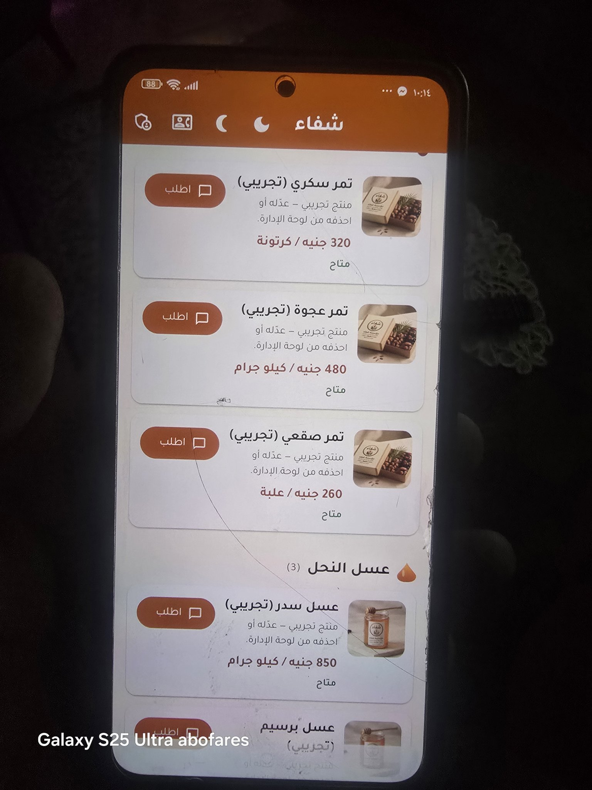
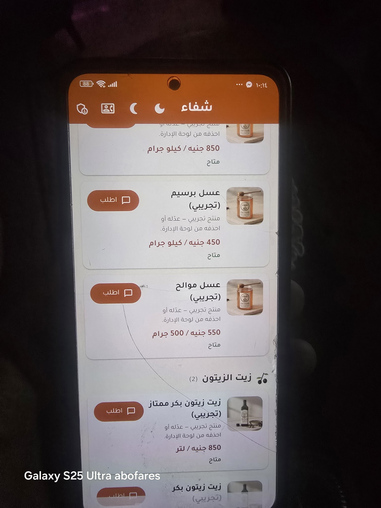
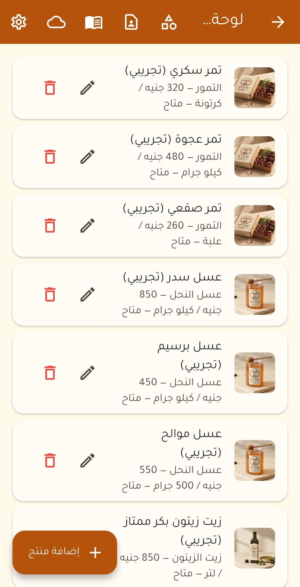

# شفاء — تطبيق مؤسسة شفاء

تطبيق أندرويد لتسويق عسل النحل والتمور وزيت الزيتون — **مؤسسة شفاء**.

## الطلب والتواصل

- زر **«اطلب»** في أي منتج يفتح واتساب برسالة الطلب جاهزة، ويرسلها العميل بنفسه.
- رقم الطلبات والتواصل: **01003079191** (واتساب وتليجرام) — الشيخ هاشم أبو خشبة (أبو عبد الرحمن).
- صفحة التواصل داخل التطبيق فيها أزرار واتساب وتليجرام وفيسبوك، وخدمات إضافية (فودافون كاش، شحن كروت، خدمات فوري، تحويل).

## الأقسام

- **التمور** — سكري، عجوة، صقعي وغيرها.
- **عسل النحل** — سدر، برسيم، موالح وغيرها.
- **زيت الزيتون** — بكر ممتاز وبكر.

## المزايا

- لوحة إدارة داخل التطبيق: إضافة وتعديل وحذف المنتجات، وتحديد الكمية بالجرام، ورفع صورة المنتج من الهاتف فتصل إلى كل العملاء مباشرة، وإدارة الأقسام وبطاقة التواصل والأذكار والآيات.
- مزامنة لحظية: أي إضافة أو تعديل من لوحة الإدارة يظهر للجميع مباشرة.
- قسم **أذكار وآيات**: آية اليوم (تتغير يومياً مع التاريخين الهجري والميلادي)، ومكتبة آيات، وأذكار الصباح والمساء وبعد الصلاة والنوم والاستيقاظ مع عدّاد تسبيح.
- تذكير يومي بالأذكار، ووضعان داكن وفاتح بهوية المؤسسة.

## التثبيت

📥 **[تحميل تطبيق شفاء — الإصدار 1.0.8 (APK)](https://github.com/shifa-app/shifa-app/releases/download/v1.0.8/shifa-app-1.0.8.apk)**

أو حمّل أحدث إصدار من صفحة **[الإصدارات (Releases)](https://github.com/shifa-app/shifa-app/releases)**، وثبّته على جهاز أندرويد.

- الإصدار الحالي: **1.0.8**
- الحزمة: `com.shifa.app`

## لقطات من التطبيق

### الرئيسية — قسم التمور

### الرئيسية — عسل النحل وزيت الزيتون

### صفحة التواصل

### لوحة الإدارة

---

جميع الحقوق محفوظة © مؤسسة شفاء
